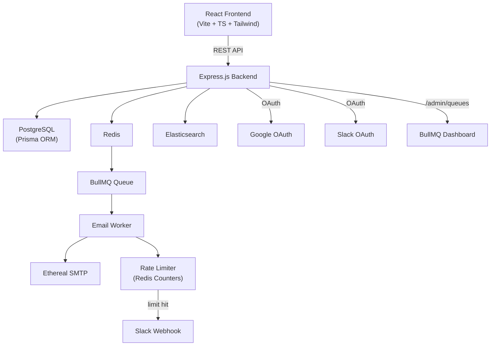

# ReachInbox Email Scheduler - Build Plan

## Architecture Overview



## Project Structure
```
Assignment/
├── docker-compose.yml          # Redis, PostgreSQL, Elasticsearch
├── backend/
│   ├── prisma/schema.prisma
│   ├── src/
│   │   ├── index.ts            # Express server + BullMQ dashboard
│   │   ├── config/             # DB, Redis, ES, SMTP configs
│   │   ├── routes/             # API routes
│   │   ├── controllers/        # Request handlers
│   │   ├── services/           # Business logic
│   │   ├── workers/            # BullMQ email worker
│   │   ├── middleware/         # Auth middleware
│   │   └── types/              # TypeScript types
│   ├── package.json
│   └── tsconfig.json
├── frontend/
│   ├── src/
│   │   ├── components/         # Reusable UI components
│   │   ├── pages/              # Login, Dashboard
│   │   ├── hooks/              # Custom hooks
│   │   ├── services/           # API client
│   │   ├── types/              # TypeScript types
│   │   └── App.tsx
│   ├── package.json
│   └── vite.config.ts
└── README.md
```

## Key Design Decisions

| Concern | Solution |
|---------|----------|
| **Scheduling** | BullMQ delayed jobs (no cron) |
| **Persistence** | Redis AOF + PostgreSQL records; BullMQ auto-recovers on restart |
| **Idempotency** | Unique BullMQ job IDs derived from DB email record ID |
| **Rate Limiting** | Redis INCR with TTL per `sender:hourWindow` key |
| **Concurrency** | BullMQ worker concurrency (configurable via env) |
| **Throttling** | BullMQ `limiter` option + custom delay between sends |
| **Search** | Elasticsearch indexing on email create/send |
| **Slack Notify** | OAuth flow → store webhook → POST on rate limit hit |
| **Google Login** | Passport.js Google OAuth 2.0 strategy |

## Build Phases

1. **Phase 1**: Docker infra + Backend scaffolding + DB schema
2. **Phase 2**: Core API (CRUD emails, scheduling, BullMQ worker)
3. **Phase 3**: Rate limiting, concurrency, Slack integration
4. **Phase 4**: Elasticsearch, BullMQ dashboard
5. **Phase 5**: Frontend (Login, Dashboard, Compose, Tables)
6. **Phase 6**: README + Polish
